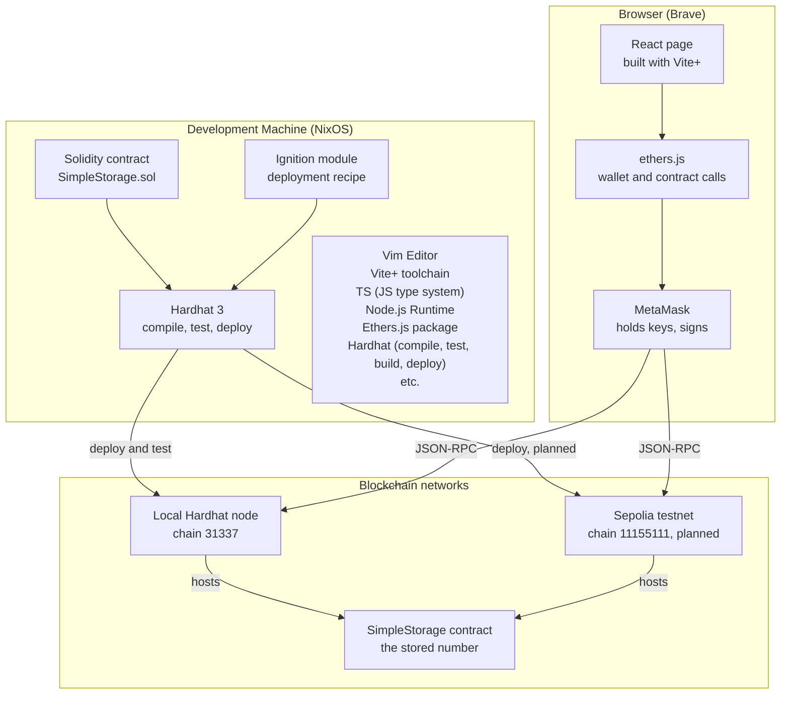
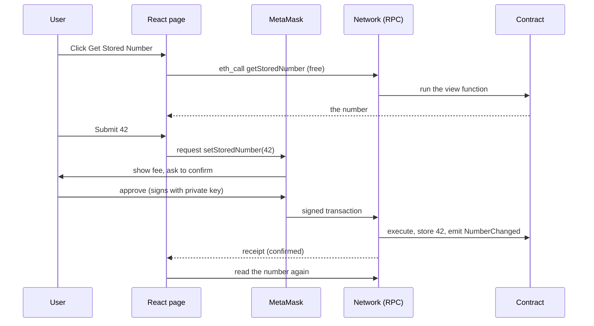

# ASSIGNMENT 2: HifadhiChain

## What it is

- HifadhiChain is a minimal full-stack decentralised application (DApp).
- React page lets anyone read, and change with their own wallet, a single number stored in a Solidity smart contract on Ethereum.

    - **Frontend:** React web page.
    - **Backend:**
        - the deployed contract: holds the data (`storedNumber`)
        - the logic: (`getStoredNumber`, `setStoredNumber`)
        - an audit log (the `NumberChanged` event).
          
    - **No traditional server or database.**

---
## Problems being solved

**The project doesn't solve a real world problem. It is a demonstration of an idea:**
- How a value can be stored so that anyone can read it
- anyone can update it under fixed rules
- nobody can secretly rewrite its history
- and no single operator can switch it off?

It's a learning proj for how every DApp is built.

**Engineering problems solved along the way:**

| Problem                                      | Solution                                                                                                |
| -------------------------------------------- | ------------------------------------------------------------------------------------------------------- |
| Trusting contract code before deploying it   | - Four automated tests on a simulated chain                                                             |
| Repeatable deployment                        | - Hardhat Ignition recipe; a rerun reports "nothing new to deploy"                                      |
| Version drift between machines and over time | - Exact version pins<br>- Lockfiles (`package.json.lock`)<br>- Locking node `engines` version           |
| Getting test funds on a local chain          | `fund:local` script sends ETH from a prefunded Hardhat account                                          |
| Secrets and keys                             | - Public vs secret handling,<br>- `.gitignore` (e.g., `.env`)<br>- Hardhat encrypted keystore (planned) |
| Consistent code style                        | - Prettier with a Solidity plugin<br>- solhint<br>- Vite+'s linter and formatter for the frontend       |

---
## Tools used




---
#### LAYERS AND JS PACKAGES

| Layer     | Tool                                               | Version          | Role                                                    |
| --------- | -------------------------------------------------- | ---------------- | ------------------------------------------------------- |
| Contract  | Solidity                                           | 0.8.28           | The language the contract is written in                 |
|           | solc (npm package)                                 | 0.8.28           | Compiler, JS/WASM so it runs on NixOS                   |
| Framework | Hardhat                                            | 3.20.0           | Compile, test, local node, deploy                       |
|           | hardhat-toolbox-viem                               | 5.0.7            | Plugin bundle *(viem, test runner, Ignition, keystore)* |
|           | Hardhat Ignition                                   | 3.1.9            | Declarative, repeatable deployment                      |
|           | viem                                               | 2.57.7           | Talks to the contract in tests and scripts              |
|           | node:test                                          | Node built-in    | Test runner                                             |
|           | TypeScript (root)                                  | 7.0.2            | Config, tests and scripts                               |
| Quality   | Prettier + prettier-plugin-solidity                | 3.9.10 / 2.4.1   | Solidity formatting                                     |
|           | solhint                                            | 6.2.5            | Solidity linting                                        |
| Frontend  | React                                              | 19.3.1           | UI components and hooks                                 |
|           | TypeScript (frontend)                              | 6.0.3            | Type safety                                             |
|           | Vite+ (`vp`)                                       | 1.3.0            | Dev server, build, lint (oxlint) and format (oxfmt)     |
|           | @vitejs/plugin-react                               | 6.1.2            | React support for Vite                                  |
|           | ethers.js                                          | 6.17.0           | Wallet connection and contract calls                    |
| Wallet    | MetaMask in Brave                                  | n/a              | Holds keys, asks the user to approve and sign           |
| Platform  | NixOS, Node.js, npm                                | 22.23.2 / 10.9.8 | Environment                                             |
| Planned   | Public Sepolia RPC endpoint, PoW faucet, Etherscan | n/a              | Public testnet deployment                               |

---
## Working And Web3 Concepts



| Web3 idea/ concept      | In HifadhiChain                                                                           | Web2 equivalent it replaces          |
| ----------------------- | ----------------------------------------------------------------------------------------- | ------------------------------------ |
| Wallet-based identity   | - MetaMask address and signature authorise changes.<br>- There is no account or password. | Login system                         |
| Verifiable shared state | The number lives on a public ledger anyone can check.                                     | Private database                     |
| Permissionless access   | Anyone with a wallet and gas can read or write.                                           | Sign-up and approval                 |
| Transparent audit trail | `NumberChanged` logs who changed what, and when.                                          | Admin-only logs                      |
| Immutable rules         | The contract's logic can't be changed after deployment.                                   | Server code the operator can edit    |
| Open composability      | The address and ABI are public, so any other app can use the same contract.               | Private API                          |
| No single operator      | Taking our frontend down doesn't delete the data.                                         | The server owner controls everything |

---
## Concepts learned

**Blockchain fundamentals**

- A blockchain is a shared, append-only ledger with confirmed blocks, immutability and deterministic execution.
- Identity is cryptographic. A public address, a private key and a recovery phrase are three different things, and an account can be derived from a phrase.
- A signature is the proof of authorisation.
- Reads are free (`eth_call`). Writes are transactions that cost gas.
- Network types differ: local, testnet and mainnet. Chain IDs tell them apart.

**Smart contracts**

- A contract has state variables, `view` vs state-changing functions, events and `msg.sender`.
- `private` hides a name from other contracts. It doesn't make data secret.
- The ABI and bytecode come out of compilation.
- A deployed contract is immutable, and the address is how you find it.

---
## DEMO LIMITS

- No access control: anyone can overwrite the number.
- The frontend is still centralised on GitHub Pages once published, and every request goes through a third-party RPC endpoint.

---
## Repo structure

```
hifadhi_chain/
├── contracts/
│   └── SimpleStorage.sol            # the smart contract (the "backend")
├── test/
│   └── SimpleStorage.ts             # 4 automated tests (node:test + viem)
├── ignition/
│   ├── modules/
│   │   └── SimpleStorage.ts         # deployment recipe (Hardhat Ignition)
│   └── deployments/                 # Ignition's records (local chain folder is git-ignored)
├── scripts/
│   └── fund_local_account.ts        # sends local test ETH to a wallet address
├── hardhat.config.ts                # compiler (npm solc), plugins, networks
├── package.json / package-lock.json # pinned toolchain and npm scripts
├── .prettierrc.json                 # Solidity formatting rules
├── .solhint.json                    # Solidity lint rules
├── .gitignore
├── artifacts/  cache/               # generated by Hardhat (git-ignored)
├── frontend/
│   ├── index.html                   # page shell and title
│   ├── vite.config.ts               # build, lint and format config (Vite+)
│   ├── package.json / package-lock.json
│   ├── tsconfig.json  tsconfig.app.json  tsconfig.node.json
│   ├── .env.local                   # contract address for dev (git-ignored)
│   ├── .gitignore
│   ├── public/                      # static assets (favicon)
│   └── src/
│       ├── main.tsx                 # React entry point
│       ├── App.tsx                  # page layout (header, main, sections)
│       ├── use_wallet.ts             # all wallet and contract logic
│       ├── config.ts                # contract address, supported chains, ABI
│       ├── ethereum.d.ts            # types for window.ethereum
│       ├── index.css                # styles
│       └── components/
│           ├── wallet_panel.tsx       # connect button, account and network
│           ├── stored_number.tsx      # shows the number, read button
│           ├── change_number_form.tsx # form to set a new number
│           ├── contract_info.tsx      # shows the contract address
│           └── status_message.tsx     # live status, errors, Etherscan link
├── docs/                            # project plan and notes
├── .github/workflows/deploy.yml     # (planned) publish the frontend to GitHub Pages
└── README.md                        # (planned) how to run and use the project
```

**How the pieces connect:**

- `hardhat.config.ts` tells Hardhat which compiler and plugins to use. Compiling `SimpleStorage.sol` produces the ABI and bytecode.
- The tests and the Ignition module both use the compiled contract. Ignition deploys it, and the local node prints its address.
- That address lives in `frontend/.env.local`, and `config.ts` reads it.
- `use_wallet.ts` uses `config.ts` to talk to MetaMask and the contract. The React components only display its state.
- `fund:local` funds the wallet account with test ETH so it can pay gas on the local chain.
