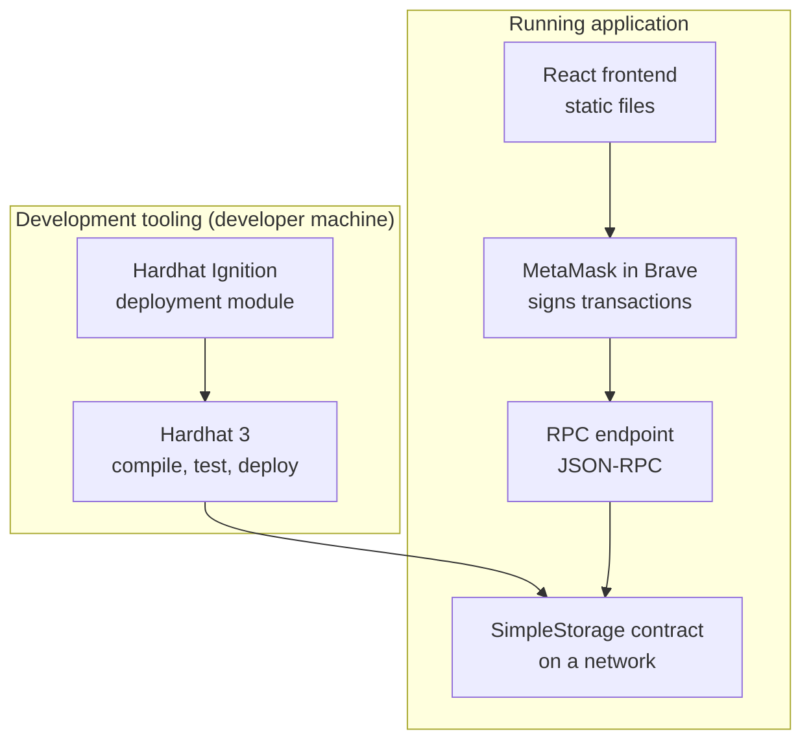
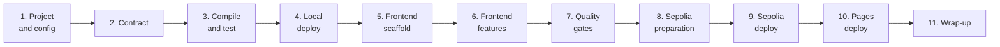

# HifadhiChain: Project Plan and Deviation Register

| Field                  | Value                                                                                                                               |
| ---------------------- | ----------------------------------------------------------------------------------------------------------------------------------- |
| Status                 | Draft v1. Stack locked; environment canary passed                                                                                   |
| Date                   | 2026-10-17                                                                                                                          |
| Source specification   | ["HifadhiChain DApp Guide"](_hifadhichain_dapp_guide.pdf):<br>- Solidity, Hardhat 3, Hardhat Ignition, MetaMask, ethers.js, Sepolia |
| Target machine         | NixOS, Node.js 22.23.2, npm 10.9.8, Brave browser with MetaMask                                                                     |
| Scope of this document | - The locked stack<br>- The deviations from the source specification (with reasons)<br>- The build sequence.                        |


---

## 1. Purpose and approach

HifadhiChain is a learning project:

- A minimal full-stack decentralised application (DApp) that stores one number on the Ethereum blockchain.
- The goal is to build the deliverable described by the source guide, with the deviations recorded in section 7, and to treat everything the project does not touch as later improvements (section 9), implemented after the core works.

Working rules:

1. **Spec first:**
    - The core deliverable follows the source guide.
    - Improvements wait until the core is complete.
2. **Every deviation is written down** with its reason, its category and its fallback.
3. **Everything is pinned:**
    - Exact versions in `package.json`, committed lockfiles, and an `engines` field.
4. **Local first:**
    - The core is accepted on a local chain.
    - The public test network is a late step.
5. **No real money, ever:**
    - No mainnet network is configured anywhere in the project.

---

## 2. What is being built

- HifadhiChain is a public whiteboard that holds exactly one unsigned integer. 
- Anyone can read it.
- Anyone with a wallet that holds a little of the network's currency can overwrite it.
- Every change is recorded permanently in an event log.

**It does not solve a practical problem:**

- It is the "hello world" of EVM development:
    - it demonstrates the architecture shared by every DApp *(state and logic on-chain, a UI in the browser, a wallet as identity).*

**Frontend and backend:**

- The web page is the frontend.
- The deployed smart contract is the backend:
    - `storedNumber` is the data
    - `getStoredNumber()` and `setStoredNumber()` are the logic
    - `NumberChanged` event is the audit log.
- Hardhat, the tests and Ignition are development tooling and are not part of the running application.



**Concepts the project touches:**

|Concept|Where it appears|
|---|---|
|Keypair identity, signing|MetaMask account; deployer key|
|Transactions, gas, faucets|`setStoredNumber`; Sepolia deployment|
|Read vs write (`eth_call` vs transaction)|`view` getter vs setter|
|Contract storage, events, `msg.sender`|`storedNumber`, `NumberChanged`|
|ABI and bytecode|Compile artifacts; ABI used by the frontend|
|Deployment, immutability, addresses|Ignition, deployed address|
|Chain IDs, JSON-RPC, EIP-1193|31337, 11155111, `window.ethereum`|
|Confirmation|Waiting for a transaction receipt|
|Testing on a simulated chain|`node:test` + viem|
|Key hygiene|Hardhat keystore, `.gitignore`|

**Not covered** (candidates for section 9):
1. access control.
2. token standards.
3. upgradeability.
4. contract security issues (reentrancy etc.).
5. storage-cost optimisation.
6. event indexing.
7. decentralised frontend hosting.
8. layer-2 networks.

---

## 3. Networks

- Three networks exist conceptually.
- They are reached through RPC endpoints; Hardhat itself is the toolchain.

| Network                                                 | Chain ID | Currency                         | Role in this project                            |
| ------------------------------------------------------- | -------- | -------------------------------- | ----------------------------------------------- |
| Hardhat local network *(in-process, or `hardhat node`)* | 31337    | Valueless, prefunded accounts    | Primary development and acceptance loop         |
| Sepolia                                                 | 11155111 | Valueless test ETH from a faucet | Late-stage public test deployment               |
| Ethereum mainnet                                        | 1        | Real ETH                         | **Never used by this project.** Not configured. |

**Sepolia lifetime:**

- The Ethereum Foundation announced an end-of-life date of 30 September 2026 for Sepolia.
- That date has passed and the network is still running.
- A May 2026 proposal puts a successor network at the latest fork by Q1 2027 and a full Sepolia sunset in Q2/Q3 2027, and was open to feedback.
- A successor could not be confirmed to exist. Consequences:
    - Contracts deployed to Sepolia become unreachable when it is retired. A public demo pointed at Sepolia has a limited lifetime (roughly mid-2027).
    - Chain ID, contract address and network names live in one configuration location so a migration is a small change.

Sources:
1. [EF testnet update (Mar 2025)](https://blog.ethereum.org/2025/03/18/hoodi-holesky)
2. [replacement and sunsetting thread (May 2026)](https://ethereum-magicians.org/t/sepolia-testnet-replacement-sunsetting/28647)
3. [Sepolia faucet guide (Sep 2026)](https://nownodes.io/blog/how-to-get-sepolia-eth-the-sepolia-faucet-guide-for-2026/).

**Gas and cost safety.**

- Reading (`view` functions) is free and needs no wallet.
- Writing is a transaction and costs gas in the network's own currency. On the local network and Sepolia that currency has no value.
- Guardrails: the Hardhat config defines only `localhost` and `sepolia`; the frontend refuses to send transactions on chain IDs outside an allowlist; the development wallet holds no real funds.

---

## 4. Locked stack

- "Verified (NixOS)" means run successfully on the target NixOS machine on 2026-10-17. "Verified (Linux)" means run on stock Ubuntu Linux with Node 22.22.2. 
- Resolved versions are always recorded from the lockfile after installation.

|Component|Pin|Role|Status|
|---|---|---|---|
|Node.js|22.23.2 (system); `engines` `>=22.18.0`|Runtime for Hardhat and Vite+|Verified (NixOS)|
|npm|10.9.8 (ships with Node)|Package manager|Verified (NixOS)|
|hardhat|3.20.0|Compile, test, local node, deploy|Verified (NixOS)|
|@nomicfoundation/hardhat-toolbox-viem|5.0.7|Plugin bundle (viem, test runner, Ignition, keystore, ...)|Verified (NixOS)|
|@nomicfoundation/hardhat-ignition|3.1.9|Declarative deployment|Verified (NixOS)|
|viem|2.57.7|Contract access in tests|Verified (NixOS)|
|solc (npm package)|0.8.28|Compiler, used via Hardhat's `path` option|Verified (NixOS)|
|typescript (root)|7.0.2|Hardhat config and tests|Verified (NixOS)|
|create-vite|9.2.1|One-time frontend scaffold (not a dependency)|Verified (NixOS)|
|vite-plus|1.3.0|Frontend dev server, build, lint, format|Verified (NixOS)|
|React / react-dom|As resolved by the scaffold (template specifies `^19.2.x`)|UI|Verified (NixOS); convert to exact pins|
|typescript (frontend)|As resolved by the scaffold (template specifies `~6.0.2`)|Frontend type-checking|Verified (NixOS)|
|ethers|6.17.0|Frontend wallet and contract access|Verified (Linux) bundles and type-checks|
|prettier|3.9.10|Formatting `.sol` files|Untested|
|prettier-plugin-solidity|2.4.1|Solidity formatting rules|Untested|
|solhint|6.2.5|Solidity linting|Untested|
|Browser and wallet|Brave + MetaMask|Signing in the browser|Untested in this project|
|Hosting|GitHub Pages (static `dist/`)|Public frontend|Untested|

Not used:
1. Bun *(Hardhat documents Node 22+ with `npm, pnpm or yarn`)*
2. Live Server

---

## 5. Environment prerequisites

1. **Node.js 22.18 or later** provided by the system (NixOS). npm ships with it.
2. **Git.**
3. **Brave browser with MetaMask:**
    1. Open `brave://settings/web3` and set the default Ethereum wallet to **Extensions (no fallback)**, so Brave Wallet does not take over `window.ethereum`.
    2. Use a **separate Brave profile** with its own MetaMask for development.
    3. Hardhat's local accounts have publicly known private keys; real funds sent to them on any live network are lost.
4. Nothing else is installed globally. Slither and a system `solc` are optional later additions tracked in the separate tooling RFC. Vite+ is **not** installed globally (see D-13).

---

## 6. Repository layout

```
hifadhichain/
├── contracts/SimpleStorage.sol
├── test/SimpleStorage.ts
├── ignition/modules/SimpleStorage.ts
├── hardhat.config.ts
├── package.json            # Hardhat toolchain, exact pins, engines
├── package-lock.json
├── .prettierrc.json        # *.sol formatting
├── .solhint.json
├── .gitignore
├── frontend/               # React + Vite+ (own package.json and lockfile)
│   ├── index.html
│   ├── src/
│   ├── vite.config.ts      # build, lint and format config in one file
│   └── package.json
├── .github/workflows/deploy.yml
└── docs/                   # this plan, runbooks, notes
```

Two independent npm packages (root and `frontend/`), no workspace.

---

## 7. Deviation register

Categories: 
1. **Desired:** *(requested change).*
2. **NixOS:** *(driven by the target platform).*
3. **Drift:** *(source guide no longer matches current tooling).*
4. **Research:** *(found during analysis).*

| ID   | Deviation from the source guide                                                                                                              | Reason                                                                                                                                                                                                                                                                                                                                       | Category | Fallback / note                                                                                      |
| ---- | -------------------------------------------------------------------------------------------------------------------------------------------- | -------------------------------------------------------------------------------------------------------------------------------------------------------------------------------------------------------------------------------------------------------------------------------------------------------------------------------------------- | -------- | ---------------------------------------------------------------------------------------------------- |
| D-01 | Frontend is React with Vite+, not a single HTML file with ethers from a CDN                                                                  | Familiarity; maintainable component structure                                                                                                                                                                                                                                                                                                | Desired  |                                                                                                      |
| D-02 | Solidity compiler comes from the npm `solc@0.8.28` package, wired through Hardhat's `path` option, instead of Hardhat downloading a compiler | - Hardhat's default downloads a native executable that cannot run on NixOS.<br><br>- The npm package is JavaScript/WASM, pinned by the lockfile, and works offline after install.<br><br>- Verified on NixOS.                                                                                                                                | NixOS    | See Appendix A for the `preferWasm` and `nix-ld` fallbacks                                           |
| D-03 | Node.js comes from the system package set, not an installer; steps 1-7 of the guide (installers, PowerShell policy) are dropped              | NixOS provides Node declaratively                                                                                                                                                                                                                                                                                                            | NixOS    |                                                                                                      |
| D-04 | No `devenv`/flake in the project                                                                                                             | Node and npm are already system-provided and everything else comes from npm; project-level Nix would add nothing yet                                                                                                                                                                                                                         | NixOS    | Revisit if contributors need a reproducible toolchain                                                |
| D-05 | Tests call `network.getOrCreate()`, not `network.connect()`                                                                                  | `connect()` is deprecated in Hardhat 3.20.0 (prints a warning). `getOrCreate()` verified: four tests pass                                                                                                                                                                                                                                    | Drift    |                                                                                                      |
| D-06 | Project files are created by hand with exact pins instead of `npx hardhat --init`                                                            | - `--init` is interactive-only, uses version ranges instead of exact pins, sets solc 0.8.34 (the guide uses 0.8.28, and native compilers do not run on NixOS), and generates example files, an `AGENTS.md` and extra networks that must be removed.<br><br>- Manual creation is reproducible. Guide steps 9 and 10 disappear. See Appendix C | Drift    | If `--init` is used, follow the post-init checklist in Appendix C                                    |
| D-07 | Exact versions (`--save-exact`) and committed lockfiles                                                                                      | Avoids version drift                                                                                                                                                                                                                                                                                                                         | Desired  |                                                                                                      |
| D-08 | Brave default-wallet setting and a separate browser profile for the development wallet                                                       | The guide is silent on Brave's built-in wallet                                                                                                                                                                                                                                                                                               | Research |                                                                                                      |
| D-09 | Sepolia deployer is a fresh dedicated account whose key goes into the Hardhat keystore; no `.env` file, no `dotenv` dependency               | The guide exports a MetaMask key into a plain-text file; the keystore stores it encrypted                                                                                                                                                                                                                                                    | Research | Environment variables remain usable. Verify in Phase 8                                               |
| D-10 | Network IDs, names and the contract address live in one config module; local network is the acceptance baseline and Sepolia is a late phase  | Sepolia is scheduled for retirement                                                                                                                                                                                                                                                                                                          | Research |                                                                                                      |
| D-11 | Solidity files use Prettier + `prettier-plugin-solidity`; frontend files use the Vite+ formatter                                             | The Vite+ formatter's published language list has no Solidity                                                                                                                                                                                                                                                                                | Research |                                                                                                      |
| D-12 | Frontend lint and format configuration lives in `vite.config.ts`; the scaffold's `.oxlintrc.json` is removed once verified                   | One config file per package                                                                                                                                                                                                                                                                                                                  | Desired  | The scaffold's files do not match the formatter defaults, so a one-time baseline format is committed |
| D-13 | Frontend is scaffolded with pinned `create-vite` and then `vp migrate`, not `vp create`; Vite+ is a local devDependency only                 | `vp create vite --directory` is rejected for non-builtin templates, and `vp create` fetched an unpinned `npm@latest` in testing. The global installer manages its own Node runtime, which conflicts with system Node                                                                                                                         | NixOS    | Reasoning is repeated in the tooling RFC                                                             |
| D-14 | ethers v6.17.0 is installed from npm and bundled, instead of a pinned CDN script (6.13.5)                                                    | Bundling removes a third-party request at runtime                                                                                                                                                                                                                                                                                            | Desired  |                                                                                                      |
| D-15 | Hosting through GitHub Pages with GitHub Actions                                                                                             | Free static hosting, same repository                                                                                                                                                                                                                                                                                                         | Desired  | Vercel is the alternative                                                                            |
| D-16 | `npm audit` reports a high-severity finding in `tmp`, a dependency of the `solc` package's command-line tool                                 | It is not loaded when only `soljson.js` is imported. Accepted and documented                                                                                                                                                                                                                                                                 | Research | Re-check when `solc` publishes a fix                                                                 |

---

## 8. Build sequence



Each phase ends with a success check. Do not start the next phase until it passes.

### Phase 1: Project and configuration

1. Create the repository and the root package:
```sh
mkdir hifadhichain && \
cd hifadhichain && \
git init && \
npm init -y && \
npm pkg set type=module && \
npm pkg set engines.node=">=22.18.0"
```

2. Install the pinned toolchain:
```sh
npm install --save-exact --save-dev \
@nomicfoundation/hardhat-ignition@3.1.9 \
@nomicfoundation/hardhat-toolbox-viem@5.0.7 \
@types/node@22.20.5
hardhat@3.20.0 \
solc@0.8.28 \
typescript@7.0.2 \
viem@2.57.7 \
```
- Confirmation on pinned versions:
```bash
npm ls --depth=0
```

3. Create `.gitignore`:
```
node_modules/
artifacts/
cache/
coverage/
dist/
.env
ignition/deployments/chain-31337/
```
- The Sepolia deployment record (`ignition/deployments/chain-11155111/`) is committed; the local one is not.
  
4. Create `hardhat.config.ts` (the Sepolia network block is added in Phase 8):
```ts
   import hardhatToolboxViem from "@nomicfoundation/hardhat-toolbox-viem";
   import { defineConfig } from "hardhat/config";

   export default defineConfig({
     // The toolbox plugin provides viem, the node:test runner and Ignition.
     plugins: [hardhatToolboxViem],
     solidity: {
       version: "0.8.28",
       // Compile with the npm-provided solc (JS/WASM) instead of a downloaded native binary.
       path: new URL("./node_modules/solc/soljson.js", import.meta.url).pathname,
       settings: { optimizer: { enabled: true, runs: 200 } },
     },
   });
```

5. Add scripts to `package.json`:
    1. `compile` (`hardhat compile`).
    2. `test` (`hardhat test`).
    3. `node` (`hardhat node`).
    4. `deploy:local` (`hardhat ignition deploy ignition/modules/SimpleStorage.ts --network localhost`).

**Success check:**
- `npx hardhat compile` runs without a download and without errors (after the contract exists, Phase 2).

### Phase 2: The contract

Create `contracts/SimpleStorage.sol` exactly as in the source guide (step 15):

```solidity
// SPDX-License-Identifier: MIT
pragma solidity ^0.8.28;

/// @title HifadhiChain - SimpleStorage
/// @notice Stores one number on the blockchain.
contract SimpleStorage {
  // Kept permanently in the contract's storage.
  // "private" hides the name from other contracts only; i.e.,
  // all blockchain data is publicly readable.
  uint256 private storedNumber;

  // Written to the transaction log every time the number changes.
  event NumberChanged(uint256 oldNumber, uint256 newNumber, address changedBy);

  constructor() {
    storedNumber = 0;
  }

  // A free read: does not change the blockchain.
  function getStoredNumber() public view returns (uint256) {
    return storedNumber;
  }

  // A write: needs a signed transaction and gas.
  function setStoredNumber(uint256 _newNumber) public {
    uint256 oldNumber = storedNumber;
    storedNumber = _newNumber;
    emit NumberChanged(oldNumber, _newNumber, msg.sender);
  }
}
```

**Success check:** `npx hardhat compile` prints "Compiled 1 Solidity file with solc 0.8.28".

### Phase 3: Compile and test

Create `test/SimpleStorage.ts` with the guide's four tests, using `network.getOrCreate()` (D-05):

```ts
import assert from "node:assert/strict";
import { describe, it } from "node:test";
import { network } from "hardhat";

describe("SimpleStorage", async function () {
  const { viem } = await network.getOrCreate();

  it("should start with zero", async function () {
    const s = await viem.deployContract("SimpleStorage");
    assert.equal(await s.read.getStoredNumber(), 0n);
  });
  it("should store a new number", async function () {
    const s = await viem.deployContract("SimpleStorage");
    await s.write.setStoredNumber([42n]);
    assert.equal(await s.read.getStoredNumber(), 42n);
  });
  it("should replace the previous number", async function () {
    const s = await viem.deployContract("SimpleStorage");
    await s.write.setStoredNumber([42n]);
    await s.write.setStoredNumber([100n]);
    assert.equal(await s.read.getStoredNumber(), 100n);
  });
  it("should emit NumberChanged", async function () {
    const s = await viem.deployContract("SimpleStorage");
    await viem.assertions.emit(s.write.setStoredNumber([7n]), s, "NumberChanged");
  });
});
```

- Numbers end in `n` because blockchain integers are JavaScript `BigInt` values.

**Success check:** `npx hardhat test` shows four passing tests and no deprecation warning.

### Phase 4: Local deployment

1. Create `ignition/modules/SimpleStorage.ts`:
```ts
import { buildModule } from "@nomicfoundation/hardhat-ignition/modules";
export default buildModule("SimpleStorageModule", (m) => {
   const simpleStorage = m.contract("SimpleStorage");
   return { simpleStorage };
});
```
  
2. Deploy to the temporary in-process network:
    - `npx hardhat ignition deploy ignition/modules/SimpleStorage.ts`.
3. Start a persistent node in one terminal:
    - `npm run node`.
    - It serves `http://127.0.0.1:8545` with chain ID 31337 and prefunded accounts. Leave it running.
4. In a second terminal:
    - `npm run deploy:local`.
    - Record the printed address.
    - On a fresh node the first deployment from the first account prints `0x5FbDB2315678afecb367f032d93F642f64180aa3`.
5. In the **development** Brave profile's MetaMask, add a network manually (RPC `http://127.0.0.1:8545`, chain ID 31337, currency ETH) and import one of the printed accounts.

**Success check:**
- both deployments print an address.
- After restarting the node, MetaMask may report "nonce too high"; clear its activity data for the account (to be captured as a runbook).

### Phase 5: Frontend scaffold

Run in the repository root (verified sequence):

1. Scaffold with the pinned generator. `--no-interactive` skips prompts; `--no-immediate` stops it installing and launching the dev server by itself:
```sh
npm create vite@9.2.1 \
frontend -- \
--template react-ts \
--no-interactive \
--no-immediate
```

2. Add Vite+ as an exact-pinned local dependency:
```sh
cd frontend && \
npm install --save-exact --save-dev \
vite-plus@1.3.0 \
@types/node@22.20.5
```

3. Migrate to Vite+. `npx --no-install` uses the local binary (never downloads one) and puts `node_modules/.bin` on the PATH, which the migration needs:
```sh
npx --no-install
```
- **NOTE: THE COMMAND WILL THROW YOU INTO A SHELL. *From there, run the `vp migrate ...` command. I believe it's there where the `vp` command is available:***
```bash
vp migrate \
--no-agent \
--no-editor \
--no-hooks \
--no-interactive
```
- The migration rewrites the scripts to `vp dev`, `vp build`, `vp lint` and `vp preview`, aliases `vite` to Vite+'s core package (with a matching `overrides` entry), switches `vite.config.ts` to import `defineConfig` from `vite-plus`, and installs dependencies.
  
4. Add `ethers` and the `engines` field, plus the package/app name:
```sh
npm install --save-exact ethers@6.17.0 && \
npm pkg set engines.node=">=22.18.0" && \
npm pkg set name=hifadhi_chain_frontend
```

5. **Convert the caret ranges of direct dependencies to the exact resolved versions:** 
    - At this point, Dependencies like `react` still carry `^` and `~`.
    - The script below rewrites them to the versions our lockfile already resolves, so nothing is downloaded.
    - From `frontend/`:
```bash
cat > /tmp/pin_versions.mjs <<'EOF'
import { readFileSync, writeFileSync } from "node:fs";
const pkg = JSON.parse(readFileSync("package.json", "utf8"));
const lock = JSON.parse(readFileSync("package-lock.json", "utf8"));
for (const section of ["dependencies", "devDependencies"]) {
  for (const [name, range] of Object.entries(pkg[section] ?? {})) {
    if (/^[\^~]/.test(range)) {
      const resolved = lock.packages[`node_modules/${name}`].version;
      console.log(`${name}: ${range} -> ${resolved}`);
      pkg[section][name] = resolved;
    }
  }
}
writeFileSync("package.json", JSON.stringify(pkg, null, 2) + "\n");
EOF
node /tmp/pin_versions.mjs
```

6. **Verify from the lockfile:**
```bash
npm ci && npm run build && npm run lint
```

7. In `vite.config.ts`:
    1. set `base: './'` (Phase 10) and move lint. Put it inside `defineConfig({ … })` in `vite.config.ts`, for example just after `plugins: [react()],`. GitHub Pages needs it later.
    2. Format settings into the file (`npx vp lint --init`, `npx vp fmt --init` add the `lint` and `fmt` keys)
        - Remove `.oxlintrc.json` once `npm run lint` passes.
        - A good sign: `vp migrate` moved the lint settings into `vite.config.ts` and left no `.oxlintrc.json`, so D-12 *(a single config file)* is already satisfied. The `vite-plus/prefer-vite-plus-imports` rule enforces importing from `vite-plus` rather than `vite`.
    
8. **Baseline format.** Run `npx --no-install vp fmt` once so the component diffs stay clean.

**Success check:**
- `npm run build` and `npm run lint` pass in `frontend/` (both passed on the NixOS machine for the unmodified scaffold).

### Phase 6: Frontend features

- The behaviour follows the source guide (sections 3 to 7 of its script):
    - connect the wallet.
    - check the network.
    - read the number.
    - write a number.
    - report status.
- The structure is React components and hooks instead of DOM manipulation.

**Configuration module** (`src/config.ts`):
- contract address from `import.meta.env.VITE_CONTRACT_ADDRESS`, the supported chains (`11155111` Sepolia, `31337` Hardhat local), and the hand-copied ABI (two functions) from the compiled artifact.

**Behaviour:**

1. _Connect:_
    - request accounts from `window.ethereum`, create a `BrowserProvider` and signer, read the chain ID, reject unsupported chains with a status message, create the `Contract`, then read the stored number.
2. _Read:_
    - call `getStoredNumber()`; no wallet pop-up, no gas.
3. _Write:_
    - accept only whole numbers (`/^\d+$/`), call `setStoredNumber(BigInt(value))`, wait for the receipt, re-read the number, show an Etherscan link only on Sepolia.
4. _Wallet events:_
    - reload (or reset state) when the account or chain changes.

**Semantic HTML conventions.** Element choices are deliberate and explained in code comments:

|UI part|Element|Reason|
|---|---|---|
|Page title and intro|`<header>` with `<h1>`|Identifies the page's introductory content|
|Page content|`<main>`|The single primary landmark|
|Each feature block|`<section aria-labelledby="...">` with a heading|A named region; assistive technology can navigate by region|
|Wallet, network, contract details|`<dl>` with `<dt>`/`<dd>`, addresses in `<code>`|Name/value pairs; addresses are literal text|
|Stored number|`<output>`|The result of a user-initiated read|
|Number input|`<form>`, `<label htmlFor>`, `<input type="number" inputMode="numeric" min="0" step="1" required>`, `<button type="submit">`|Enter submits, built-in validation, labelled field|
|Connect / read actions|`<button type="button">`|Actions, not navigation|
|Status messages|`<p role="status">`|Announced politely without moving focus|
|Etherscan link|`<a rel="noopener noreferrer" target="_blank">`|Navigation to an external page|

**Success check:** on the local chain in the development Brave profile:
- connect, see `0`, set `42` and `100`, observe each value after confirmation, and observe the refusal on an unsupported chain.

### Phase 7: Quality gates

1. Install the Solidity formatter and linter in the root package (exact pins):
```sh
npm install --save-exact --save-dev \
prettier@3.9.10 \
prettier-plugin-solidity@2.4.1 \
solhint@6.2.5
```

2. `.prettierrc.json`:
```json
{
  "plugins": ["prettier-plugin-solidity"],
  "overrides": [
    {
      "files": "*.sol",
      "options": {
        "printWidth": 80,
        "tabWidth": 2,
        "useTabs": false,
        "singleQuote": false,
        "bracketSpacing": false
      }
    }
  ]
}
```

3. **solhint's recommended rules give 12 warnings and 0 errors.**
    - They are NatSpec doc tags, a suggestion to index event parameters, and a constructor-visibility note.
    - This tuned config gave a clean run:
```json
   {
     "extends": "solhint:recommended",
     "rules": {
       "use-natspec": "off",
       "gas-indexed-events": "off",
       "func-visibility": ["warn", { "ignoreConstructors": true }]
     }
   }
```
- Keeping the contract identical to the guide. Adding NatSpec and indexed events belongs on the improvements list.
 
4. **Quiet the banners.** solhint prints promotional terminal banners. Use `solhint --noPoster "contracts/**/*.sol"` in the `lint:sol` script.

5. Scripts:
    1. `format:sol` (`prettier --write "contracts/**/*.sol"`)
    2. `lint:sol` (`solhint "contracts/**/*.sol"`).

**Success check:**
- Both scripts run cleanly on `SimpleStorage.sol`.
    1. `npm run format:sol`
    2. `npm run lint:sol`.
- The Solidity extension for VS Code formats with the same plugin and reads the same `.prettierrc.json`, so editor and command-line output should match.

### Phase 8: Sepolia preparation

1. Check that Sepolia is still running and whether a successor has been announced (section 3 sources).
2. Create a dedicated deployer account in the development profile's MetaMask (never the primary wallet).
3. Fund it from a faucet. As of September 2026, one faucet needs only an address (proof-of-work), one needs a small mainnet balance, one needs a Google sign-in. About 0.05 test ETH is plenty.
4. Choose an RPC endpoint. A hosted provider sees every request; weigh privacy against convenience (runbook).
5. Store the secrets in the encrypted keystore:
```bash
npx hardhat keystore set SEPOLIA_RPC_URL && \
npx hardhat keystore set SEPOLIA_PRIVATE_KEY
```

6. Add the network to `hardhat.config.ts`:
```ts
import { configVariable } from "hardhat/config";
// inside defineConfig({ ... })
networks: {
  sepolia: {
    type: "http",
    chainType: "l1",
    url: configVariable("SEPOLIA_RPC_URL"),
    accounts: [configVariable("SEPOLIA_PRIVATE_KEY")],
  },
},
```
- `configVariable` is evaluated only when a Sepolia command runs, so local work is unaffected.

**Success check:**
- `npx hardhat compile` and `npx hardhat test` still pass; the keystore lists both keys.
- This phase also verifies deviation D-09.

### Phase 9: Sepolia deployment

1. `npx hardhat ignition deploy ignition/modules/SimpleStorage.ts --network sepolia`; confirm with `y` when asked.
2. Record the address from the output and from `ignition/deployments/chain-11155111/deployed_addresses.json`.
3. Check the address on Sepolia Etherscan.
4. Put the address into `frontend/.env.production` (or the repository variable `VITE_CONTRACT_ADDRESS`). It is public, never a secret.

**Success check:**
- the contract and the deployment transaction are visible on the block explorer.

### Phase 10: GitHub Pages

See  [section 8.1.](#8.1%20GitHub%20Pages%20deployment)

### Phase 11: Wrap-up

Update the documentation, write the runbooks, record the final resolved versions from both lockfiles, and review section 9.

### 8.1 GitHub Pages deployment

**Frequent failure points**

1. **`base`:**
    - A project site is served from `https://<user>.github.io/<repo>/`.
    - Vite's default base `/` makes the built page request `/assets/...` from the domain root, which returns 404 and shows a blank page.
    - Either set `base: '/<repo>/'` or use `base: './'`. `./` is chosen here because the app is a single page with no client-side routing; it builds correctly (verified).
    - It would break with deep links.
2. **Publish path:**
    - The app lives in `frontend/`, so the artifact is `frontend/dist`, not `dist`.
3. **Repository setting:**
    - _Settings → Pages → Build and deployment → Source_ must be **GitHub Actions:*.
    - Otherwise the workflow succeeds and nothing is published.
4. **Permissions:**
    - The job needs `pages: write` and `id-token: write` and the `github-pages` environment.
5. **Lockfile location:**
    - Dependency caching and `npm ci` must point at `frontend/package-lock.json`.
6. **Build-time values:**
    - `VITE_*` variables are embedded in the public bundle at build time.
    - Never put secrets in them.

**Workflow:**
- (`.github/workflows/deploy.yml`).
- The structure follows [Vite's static deployment guide](https://v6.vite.dev/guide/static-deploy) *(whose example uses older action majors).*
- The action versions below were the latest major tags on 2026-10-17 and must be confirmed on the first run, in particular the `setup-node` cache inputs.

```yaml
name: Deploy frontend to GitHub Pages

on:
  push:
    branches: ["main"]
  workflow_dispatch:

permissions:
  contents: read
  pages: write
  id-token: write

concurrency:
  group: "pages"
  cancel-in-progress: false

jobs:
  deploy:
    environment:
      name: github-pages
      url: ${{ steps.deployment.outputs.page_url }}
    runs-on: ubuntu-latest
    defaults:
      run:
        working-directory: frontend
    steps:
      - uses: actions/checkout@v7
      - uses: actions/setup-node@v7
        with:
          node-version: 22
          cache: npm
          cache-dependency-path: frontend/package-lock.json
      - run: npm ci
      - run: npm run build
        env:
          VITE_CONTRACT_ADDRESS: ${{ vars.VITE_CONTRACT_ADDRESS }}
      - uses: actions/configure-pages@v6
      - uses: actions/upload-pages-artifact@v5
        with:
          path: frontend/dist
      - id: deployment
        uses: actions/deploy-pages@v5
```
- `node-version: 22` resolves to the latest 22.x, which satisfies the 22.18 minimum of Vite+.

---

## 9. Known limitations and later improvements (ranked)

- The core is complete when the success checks of phases 1 to 10 pass. 
- Improvements follow in this order:
    - minor consistency fixes first.
    - major learning projects last.

|Rank|Improvement|Size|What it teaches|
|---|---|---|---|
|1|Wrong-network message names every supported network (the source says "switch to Sepolia" although the local chain is allowed)|Minor|Honest UX; chain IDs|
|2|Correct the source's claims: "thousands of nodes" (Sepolia is a permissioned testnet) and the `private` keyword ("hidden", but all data is public)|Minor|What the chain really guarantees|
|3|Load the ABI from the compiled artifact instead of copying it by hand|Minor|ABI as a build output|
|4|Show the `NumberChanged` history on the page|Small|Event logs, filters|
|5|More contract tests (maximum `uint256`, several senders, event arguments) and frontend component tests|Small|Test design|
|6|Unify on one library (viem) for tests and the UI|Medium|One mental model for contract access|
|7|Verify the contract source on Etherscan (`hardhat-verify`)|Medium|Verifiability|
|8|Add an owner and an `onlyOwner` modifier, with tests|Medium|Access control|
|9|Static analysis with Slither (and solhint rule tuning) once the tooling lands; confirm Slither works with Hardhat 3|Medium|Security tooling|
|10|Migrate to Sepolia's successor when it exists|Medium|Network lifecycle|
|11|Reduce trust in the RPC provider (privacy-conscious public endpoint, or own node)|Medium|Infrastructure trust|
|12|Wallet abstraction (multiple wallets, a wallet library)|Major|Wallet standards|
|13|Gas reports, Solidity-native fuzz and invariant tests, audit practices|Major|Mainnet readiness|
|14|Upgradeability patterns and storage layout|Major|Contract lifecycle|
|15|Event indexing (a subgraph or custom indexer)|Major|Reading chain history at scale|
|16|Decentralised frontend hosting (IPFS with a name service)|Major|Removing the last central piece|
|17|Deploy to a layer-2 test network|Major|Scaling layers|

---

## 10. Open verification items

| #   | Item                                                                                                                                                                                                  | When                                         |
| --- | ----------------------------------------------------------------------------------------------------------------------------------------------------------------------------------------------------- | -------------------------------------------- |
| 1   | Solidity diagnostics (compiler errors shown in the editor by a language server) with the custom compiler `path`. The current Vim setup (vim-polyglot) provides highlighting only, so this is untested | Before the tooling RFC and CypherIDE RFC_001 |
| 2   | `prettier`, `prettier-plugin-solidity`, `solhint` at the pinned versions                                                                                                                              | Phase 7                                      |
| 3   | Single-file frontend config (lint and format keys in `vite.config.ts`) and baseline format                                                                                                            | Phase 5                                      |
| 4   | Keystore-backed `configVariable` without `dotenv`                                                                                                                                                     | Phase 8                                      |
| 5   | MetaMask in Brave on the local chain, then Sepolia                                                                                                                                                    | Phases 6 and 9                               |
| 6   | Sepolia availability and faucet behaviour at deployment time                                                                                                                                          | Phase 8                                      |
| 7   | GitHub Actions versions and inputs on the first workflow run                                                                                                                                          | Phase 10                                     |
| 8   | Slither with Hardhat 3 (Hardhat 3 changed its build-info format); single-file mode needs a system `solc`                                                                                              | Tooling RFC                                  |
| 9   | `npm audit` finding on `tmp` (D-16)                                                                                                                                                                   | At each version bump                         |

---

## 11. Related documents (planned)

| Document                  | Content                                                                                                                                                                                                                                                   |
| ------------------------- | --------------------------------------------------------------------------------------------------------------------------------------------------------------------------------------------------------------------------------------------------------- |
| CypherOS RFC_003          | System tooling for Web3 development:<br>1. Home Manager packages<br>2. VS Code extension tier files for Solidity<br>3. the `cypher-os.pkgs.dev.web3` namespace<br>4. Slither and `solc`, why Vite+ is not installed globally<br>5. language-server parity |
| CypherIDE RFC_001         | Neovim support mirroring the VS Code setup                                                                                                                                                                                                                |
| Runbooks (RBK_001 onward) | 1. Bump pinned toolchain versions; deploy to a testnet and record the address<br>2. migrate when Sepolia is retired<br>3. recover from "nonce too high" after restarting the local node<br>4. rotate the deployer key                                     |

---

## Appendix A: Solidity compiler on NixOS

**Why a decision is needed:**
- By default Hardhat downloads a platform-native `solc` executable.
- A generic Linux executable expects a dynamic loader at a standard path that NixOS does not provide, so it fails to start.
- Hardhat can fall back to a WASM build when a native compiler cannot be obtained.

|Option|How|Trade-offs|
|---|---|---|
|**Chosen: npm `solc` via `path`**|`solc@0.8.28` as a devDependency; `solidity.path` points at `node_modules/solc/soljson.js`|Pinned by the lockfile, no runtime download, no executables. Adds a `tmp` audit finding (D-16). Verified on NixOS.|
|Fallback 1: `preferWasm: true`|Hardhat downloads a WASM compiler build at compile time|Version is pinned in the config but fetched at runtime from the compiler distribution; needs network on first compile; cached outside the project|
|Fallback 2: `nix-ld`|NixOS option (`programs.nix-ld.enable = true`) installs a loader shim so unpatched executables can run|Widens a system-level change; justified only if a native dependency fails|
|Not chosen: nixpkgs `solc` via `path`|Point `path` at a system compiler|The version must match the config exactly and the project depends on a system package; reserved for Slither tooling|

## Appendix B: Command summary

|Task|Command|
|---|---|
|Compile|`npx hardhat compile`|
|Test|`npx hardhat test`|
|Local persistent node|`npm run node`|
|Deploy to the local node|`npm run deploy:local`|
|Deploy to Sepolia|`npx hardhat ignition deploy ignition/modules/SimpleStorage.ts --network sepolia`|
|Frontend dev server (from `frontend/`)|`npm run dev`|
|Frontend production build|`npm run build`|
|Serve the production build locally|`npm run preview`|
|Frontend lint|`npm run lint`|
|Format `.sol` files|`npm run format:sol`|
|Lint `.sol` files|`npm run lint:sol`|

## Appendix C: Project creation: manual setup vs `hardhat --init`

### What `--init` does

`npx hardhat --init` is Hardhat's project generator. It asks where to create the project, which template to use and whether to install dependencies, then generates the template and installs dependencies with the detected package manager. It runs only in an interactive terminal: in a non-interactive shell it stops with error HHE11, so it cannot be scripted or run in CI.

Three templates ship with Hardhat 3.20.0 (named after their folders): `node-test-runner-viem` (the one this project's guide describes), `mocha-ethers` and `minimal`. The guide's tip spells the first one `node-testrunner-viem`; the template folder and the documentation use `node-test-runner-viem`.

### What `node-test-runner-viem` generates (read from the shipped template)

| Generated item | Content |
|---|---|
| `package.json` | Range specifiers (`^`, `~`) for dependencies, for example viem `^2.47.6` and TypeScript `~6.0.3`. Hardhat's own packages appear as `workspace:` references in the shipped template, which the generator resolves to published versions |
| `hardhat.config.ts` | Solidity 0.8.34 in two profiles (`default`, and `production` with the optimizer on); networks `hardhatMainnet`, `hardhatOp` and `sepolia` |
| Example code | `contracts/Counter.sol`, `contracts/Counter.t.sol` (a Solidity-native test), `test/Counter.ts`, `ignition/modules/Counter.ts`, `scripts/send-op-tx.ts` |
| Other files | `AGENTS.md`, `README.md`, `tsconfig.json`, `.gitignore` |
| Extra dependency | `forge-std`, fetched from GitHub by tag (`foundry-rs/forge-std#v1.16.2`) |

### Implications

| Aspect | `--init` | Manual setup (chosen) | What it means |
|---|---|---|---|
| Version pinning | Ranges; the lockfile fixes what `npm ci` installs, but `npm install` or `npm update` can move versions inside the ranges | Exact pins via `--save-exact`, plus the lockfile | `package.json` alone does not show what is installed under ranges |
| Compiler | Solidity 0.8.34; Hardhat downloads a native compiler by default, which does not run on NixOS | 0.8.28 from the guide, npm `solc` via `path` (D-02) | With `--init`, install `solc@0.8.34` and set `path`, or change the version. How `path` combines with the profiles structure was not tested |
| TypeScript | `~6.0.3` | 7.0.2, verified on NixOS | The template's version is the one Hardhat's authors use; fall back to 6.0.x if TypeScript 7 causes trouble |
| Example files | Present | Absent | They would be compiled and tested alongside the project; delete them (guide step 10) |
| Networks | `hardhatMainnet` is a simulated network despite its name; `hardhatOp` is a simulated OP-chain network; `sepolia` is present from the start | Only `localhost` and `sepolia` (Phase 8) | The name `hardhatMainnet` conflicts with the rule "no mainnet network is configured"; remove or rename it |
| `forge-std` | Git dependency from GitHub | Absent | Needs git and network access at install time; only required for Solidity-native tests |
| `AGENTS.md` | Generated | Absent | Agent instruction file that clutters the repository |
| Automation | Interactive only | Scriptable | Manual setup is the only option for CI or repeatable bootstrap |

### When each approach fits

- Use `--init` to explore Hardhat's current conventions or for a throwaway experiment. Generating a project in a scratch folder and comparing it with this plan is a good way to learn what changed.
- Use manual setup when the project must be reproducible and its conventions matter.

### Post-init checklist (if `--init` is used for the real project)

1. Delete the example contracts, tests, Ignition module, `scripts/` and `AGENTS.md`.
2. Pin every dependency to the exact installed version (`npm install --save-exact <package>@<version>`).
3. Remove or rename `hardhatMainnet` and `hardhatOp`; keep only the networks the project uses.
4. Align the compiler with D-02: matching `solc` package plus `path`.
5. Remove `forge-std` if Solidity-native tests are not used.
6. Add `ignition/deployments/chain-31337/` to `.gitignore`.
7. Record the resolved versions in section 4.